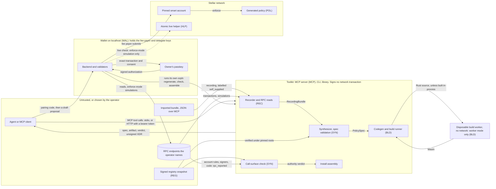

# Security audit scope

> **Draft for scoping.** The audited revision is fixed by a freeze commit named here when the
> audit starts. Until then this document describes the tree it is committed in, and its line
> counts move with that tree. The audit's findings and their remediation are logged in
> [AUDIT-REMEDIATION.md](AUDIT-REMEDIATION.md).

The entry point for an external security audit of the OZ Accounts Policy Builder: what is in
scope and why, where the claims and their limits are already written down, and how to run every
gate. It links rather than restates. Where it disagrees with a linked document, the linked
document is the one kept against the code.

## What the system does

A user or an agent points at a Stellar transaction already performed — fetched from RPC by hash,
simulated, or imported as raw XDR — and the toolkit turns it into a minimum-permission grant on an
OpenZeppelin smart account: a context rule plus a generated Soroban policy contract implementing
OpenZeppelin's `Policy` trait, which permits exactly the recorded calls (or explicit,
provenance-tagged widenings of them) for exactly the declared signers, call count and expiry. A
deterministic pipeline (recorder → PolicySpec → synthesizer → codegen) emits Rust source, a
reproducible Wasm and a BuildManifest. An independent reference evaluator, a constraint-derived
permit/deny suite and execution through the pinned account Wasm check the artifact. Before
installation a live authority check reads the account and refuses when the agent could already
change the account or reset the grant through another rule. The toolkit never signs, deploys or
installs: it prepares unsigned XDR, and the wallet re-validates it against its own RPC and has the
owner sign the installation with a passkey. Agents reach it through an MCP server and a Claude
skill, people through a CLI and the Pollywallet integration. The testnet harness is bound to
testnet. The wallet backend runs on testnet, or on mainnet only from a production build made for
mainnet and under a production registry ([mainnet runbook](MAINNET-INSTALL.md)).

## Trust boundaries and what is claimed

Read before scoping findings:

- [architecture §6](architecture.md#6-trust-security-and-privacy-model): §6.1 separates the
  claimed *authorization-minimal* guarantee from the adapter-gated *effect-minimal* one; §6.2 is
  the custody and signing boundary; §6.5 covers the confidentiality of unsigned and simulated
  transactions.
- [architecture §6.4](architecture.md#64-audit-scope-committed), the committed audit scope.
  This document is its working form.
- [architecture §10, "Acceptance gates before any mainnet use"](architecture.md#10-delivery-plan):
  the properties a mainnet release is held to.
- [SECURITY.md](../SECURITY.md#what-this-milestone-does-and-does-not-claim): what is
  deliberately not claimed.
- [SCOPE.md](SCOPE.md#implementation-boundaries): what is implemented, and the limits each part
  keeps.

| Boundary | Trusted side | Untrusted side | What crosses it |
| --- | --- | --- | --- |
| Recording | Pinned decoder, verified network passphrase | RPC responses, imported bundles, JSON over MCP | Evidence labelled by how it was acquired; serialized input is downgraded to `self_supplied` |
| Registry | Operator-configured governance roots and checkpoint | Signed snapshots, from the operator or the request | Capabilities keyed by exact Wasm hash; anything unknown is refused |
| Code generation | The template snippets in `crates/codegen` | Every recorded value | Render-safe literals only |
| Account state | The pure call-surface core | The RPC endpoint's view of the account | An `rpc_reported` observation at one ledger, not a proof |
| Signing | The wallet and the owner's passkey | MCP server, agent, hosted endpoint | Unsigned XDR only |

### Data flow

Each box is a trust zone, and an arrow between two of them crosses a trust boundary. The codes in
parentheses name the [STRIDE tables](#stride-by-component) below.



The data entities are the RecordingBundle and its evidence labels, the PolicySpec, the generated
source with its Wasm and BuildManifest, the authority verdict, the unsigned `add_context_rule`
transaction, the owner's signed authorization entries and the registry snapshot.

## Components in scope

Counted on 25 November 2026 from the tree that carries this table. *Non-test* is every non-blank
line of tracked `.rs` and `.mjs` files that is not a `//` comment (nor a `/*` or `*` comment line
in JavaScript) and is not test code. *Test* is the same measure over `tests/` directories,
`#[cfg(test)]` modules, files named `test.rs`, `tests.rs`, `*_tests.rs` or `test_support.rs`, and
`*.test.mjs`. Declaration files (`.d.mts`), TypeScript, JSON fixtures and Markdown are not counted.
To recount, define this function at the repository root and pass it the paths in a row:

```sh
loc() {
  git ls-files -- "$@" | grep -E '\.(rs|mjs)$' | xargs awk '
    FNR == 1 { whole = FILENAME ~ /(^|\/)tests\/|(^|\/)(test|tests|test_support|[a-z_]+_tests)\.rs$|\.test\.mjs$/
               js = FILENAME ~ /\.mjs$/; block = 0; attr = 0 }
    { t = whole
      if (!js) {
        if (block) { t = 1; if ($0 ~ /^}/) block = 0 }
        else if ($0 ~ /^#\[cfg\(test\)\]/) { t = 1; attr = 1 }
        else if (attr) { t = 1
          if ($0 ~ /^(pub(\(crate\))? )?mod [A-Za-z0-9_]+ \{/) { block = 1; attr = 0 }
          else if ($0 !~ /^#\[/) attr = 0 } }
      l = $0; sub(/^[ \t]+/, "", l)
      if (l == "" || l ~ /^\/\// || (js && l ~ /^(\/\*|\*)/)) next
      if (t) test++; else code++ }
    END { printf "%d non-test, %d test\n", code, test }'
}
loc crates/codegen    # 1750 non-test, 2855 test
```

A row that names files counts exactly those, with the test modules beside them
(`assembly/tests.rs`, `policy_state_capture/tests.rs`, `installed_grant/tests.rs`,
`policy_check/tests.rs`). The OpenZeppelin rows were counted with the same function in a checkout of
`OpenZeppelin/stellar-contracts` at tag v0.7.2. The account wrapper's Rust source is the same at
v0.7.3, which changes only the library's `smart_account/{mod,storage}.rs`, tests, documentation
and package versions
([SOROBAN-DEPENDENCIES.md](SOROBAN-DEPENDENCIES.md#account-073-ghsa-jpg9-m7w4-c7wc)). Python files
(the worker launcher, its two test scripts, the release script and its test) count lines that
are neither blank nor `#` comments.

The seven `crates/` rows of Tier 1, with `crates/recorder-core`, are the eight cores the mutation
gate covers: a pull request fails when a mutant on a line it changed survives that crate's tests,
and the whole set runs weekly (`scripts/mutation-test.sh`, `.github/workflows/mutation.yml`;
[DEVELOPERS.md](DEVELOPERS.md#invariants-ci-enforces-dont-break-these)).

### Tier 1 — on-chain code and security roots

| Component | Path | Why it is here | Non-test | Test |
| --- | --- | --- | ---: | ---: |
| Code generator | `crates/codegen` (`src/lib.rs`, `src/render.rs`) | The only source of generated statements ([architecture §5](architecture.md#5-why-generated-policies-stay-small-and-auditable), ring 1), the render-safe literal types, and the `contractmeta!` provenance entries (`render::MetaValue`; [ECOSYSTEM-CONFORMANCE.md](ECOSYSTEM-CONFORMANCE.md) §2) | 1,750 | 2,855 |
| Generated policies | `contracts/golden-transfer-policy`, `contracts/soroswap-swap-policy`, `contracts/range-transfer-policy`, `contracts/two-payment-policy` | The on-chain artifact, committed exactly as codegen emits it; the last two are test fixtures, a transfer whose amount is bounded on both sides and a rule with two tuples of one function | 1,181 | tested below |
| Atomic live helper | `contracts/atomic-live-helper` | On-chain contract the owner signs into for the [live-enforcement check](ATOMIC-LIVE-HELPER.md) | 163 | 50 |
| Registry | `crates/registry` | Governance roots, rollback and equivocation resistance, capabilities by exact hash, the account method inventory; the custodian, replay and monitoring logic in `src/governance.rs` ([REGISTRY-GOVERNANCE.md](REGISTRY-GOVERNANCE.md)) | 1,828 | 3,213 |
| Call-surface core | `crates/call-surface-core` | The install-time authority verdict | 1,101 | 1,509 |
| Synthesizer | `crates/synthesizer` | Exact-by-default decisions, adapters, composition checks | 1,752 | 2,404 |
| PolicySpec | `crates/policy-spec` | Schema, validation typestate, signer-set hash | 1,357 | 1,473 |
| Reference evaluator | `crates/evaluator` | The independent oracle generated code is compared with | 370 | 689 |
| Domain | `crates/domain` | Canonical hashing, trust labels and the pinned upstream hashes every row above depends on | 848 | 642 |
| Contract tests | `contracts/differential` | Differential, generated-suite (the two-payment cross products included), event, TTL and pinned-account tests of the contracts above | — | 6,981 |
| Pinned OpenZeppelin account | `examples/multisig-smart-account/account` at v0.7.3 | The account every grant is installed into; see below | 57 | not counted |
| Other pinned OpenZeppelin wrappers | `examples/multisig-smart-account/{spending-limit-policy,ed25519-verifier,webauthn-verifier}` at v0.7.2 | Recognized by exact hash; the spending limit is composed in the [subscription walkthrough](WALKTHROUGH-SEP41.md) | 112 | not counted |
| **Tier 1** | | | **10,519** | **19,816** |

**The pinned account is outside OpenZeppelin's own audit.** Their v0.7.0 audit report (in the
`audits/` directory of their repository) lists only `packages/` files in scope. The account this
repository recognizes is the *example* wrapper in `examples/multisig-smart-account/account`: 57
lines that choose which library traits to expose (`SmartAccount`, `ExecutionEntryPoint`,
`Upgradeable`) and add a constructor and `batch_add_signer`. The library it delegates to is in
that scope; the wrapper, and this repository's reliance on it, are not. The authority check's
model of it is the reviewed method inventory in `crates/registry/src/account_methods.rs`
([limits](ACCOUNT-METHOD-INVENTORY.md)). Its exact hash is `OZ_SMART_ACCOUNT_WASM` in
`ozpb_domain::pinned_upstream` (`crates/domain/src/lib.rs`);
[SOROBAN-DEPENDENCIES.md](SOROBAN-DEPENDENCIES.md) states which release is recognized, and
`scripts/verify-pinned-upstream.sh` rebuilds it from source.

### Tier 2 — paths that feed trust decisions

| Component | Path | Why it is here | Non-test | Test |
| --- | --- | --- | ---: | ---: |
| Recorder core | `crates/recorder-core` | Authorizer selection, evidence trust derivation, attribution | 1,808 | 2,679 |
| RPC acquisition | `crates/source-rpc`: `src/account_*.rs`, `checked_account_observation.rs`, `classic_account.rs`, `contract_code.rs`, `contract_data.rs`, `ledger_witness.rs`, `assembly.rs`, `policy_state_capture.rs`, `lib.rs`; `tests/{account_storage_conformance,rpc_conformance,mainnet_corpus}.rs` | The account scan behind the authority check, transaction recording (replayed over ten verbatim mainnet transactions), the reads behind install assembly and the live policy check | 4,777 | 6,966 |
| Toolkit operations | `crates/toolkit`: `src/lib.rs`, `verification.rs`, `install_intent.rs`, `install_assembly.rs`, `call_surface.rs`, `call_surface_live.rs`, `authority_text.rs`, `installed_grant.rs`, `policy_check.rs`; tests in `src/test_support.rs`, `src/target_adapter_tests.rs`, `tests/` | Trust lowering at the synthesis boundary, recognition of generated artifacts by rebuilding them, install intent and unsigned assembly | 3,419 | 5,041 |
| Wallet validators | `wallet/shared` | Independent re-validation of assembly, consent, revocation and replacement, against the network the session is bound to | 1,864 | 12,492 |
| Wallet backend install path | `wallet/server/`: `actions.mjs`, `install.mjs`, `network.mjs`, `live-signing.mjs`, `http.mjs`, `session.mjs`, `tool.mjs`, `fee-payer.mjs` | Consent, signature collection, submission, event-verified records; on mainnet, the operator's fee-payer key and the reading of the delegate's key file | 2,588 | in the wallet validators row (all of `wallet/tests`) |
| Wallet mainnet configuration, delegate key and live check | `wallet/server/`: `config.mjs`, `pinned-code.mjs`, `live-check.mjs`, `native-execution.mjs`, `native-protocol.mjs` | The operator configuration: the development root refused on mainnet, the persisted checkpoint and the registry floor, the fee caps and their ceilings. The checks of the pinned account and verifier code on the network. The live check, whose owner and delegate signatures are real authorizations on the session's network until they expire, and on mainnet are signed with the agent's own key. The delegate key's three signing capabilities and the guard that keeps offline signatures off every live network | 757 | in the wallet validators row |
| Production endpoint's HTTP boundary | `crates/mcp-server`: `src/http.rs`, `src/tool_limits.rs`, `src/preflight.rs`; `tests/{mcp_http,mcp_stdio_preflight}.rs` | The released self-hosted endpoint ([self-hosting](SELF-HOSTING.md#production-release)): bearer authentication before any quota is spent or body read, the request and per-tool quotas, the body bound, allowed hosts, the RPC allowlist every configured source must pass at startup, and the hosted refusal of signed envelopes ([G12](MAINNET-GATES.md#g12-hosted-processing)) | 470 | 1,040 |
| Build runner and worker isolation | `crates/build-runner`, `deployment/worker-launcher.py` (tested by `scripts/test-worker-launcher.py` and `scripts/test-worker-containment.py`) | Bounded builds; the BuildManifest (`build-manifest/v2`) and its `producer` record (`build.rs`, `src/toolkit_source.rs`); reconciliation against the Wasm's own metadata; [disposable workers](ISOLATED-BUILDS.md) | 2,622 | 2,460 |
| Registry governance CLI | `crates/cli/src/registry.rs`, `src/key_file.rs`; `tests/registry_governance_cli.rs` | `ozpb registry`: custodian keys in 0600 files, successor, signing, combining and verification, and the monitor whose exit status is the alert | 523 | 929 |
| **Tier 2** | | | **18,828** | **31,607** |

### Informational — not in scope

| Component | Non-test | Test | Note |
| --- | ---: | ---: | --- |
| Rest of `crates/mcp-server` | 1,544 | 2,815 | Thin shell; its HTTP boundary is in Tier 2 |
| Rest of `crates/cli` | 2,884 | 2,033 | Thin shell, except that `ozpb dry-run` holds a delegate key (`src/dry_run/`; see SECURITY.md) |
| `crates/api-types` | 1,127 | 1,215 | Wire types and stable error codes |
| `crates/harness` | 1,198 | 1,048 | Derives the permit/deny suite: evidence, not enforcement |
| `crates/source-bundle` | 47 | 198 | Import adapter whose output is `self_supplied` |
| Rest of `crates/source-rpc` (target and footprint capture, target Wasm, preflight; `tests/{target_capture_conformance,protocol30_headers}.rs`) | 1,694 | 2,672 | Dry-run and preflight evidence |
| Rest of `crates/toolkit` (dry run, its report, preflight, capture, publication) | 2,002 | 1,694 | Same |
| `execution-runtime` | 2,577 | 2,133 | Offline native worker for the account-Wasm layer |
| Rest of `wallet/server` | 1,019 | — | Monitoring, the native worker process and captured-execution glue, the agent draft bridge, startup |
| `scripts/release-artifacts.py` (tested by `scripts/test-release-artifacts.py`), run by `.github/workflows/release-binaries.yml` | 341 | 343 | Packages the release binaries, exports the MCP wire contract and writes `SHA256SUMS`; the workflow, not counted, attests and attaches them ([VERSIONING.md](VERSIONING.md#the-release-gate)). CI also runs its export against the built server and fails when it differs from the committed `docs/wire-contract.json` ([keeping the snapshot current](VERSIONING.md#keeping-the-snapshot-current)) |
| `testnet-harness`, `scripts/demo-tranche1.sh`, `skills/`, `wallet/overlay`, docs | — | — | Testnet demonstration, agent instructions, wallet UI |
| `contracts/authorized-target-fixture`, `tests/support` | — | — | Test-only: the target contract the pinned-account authorization test (`scripts/test-pinned-account-authorization.sh`) builds and calls through the account, and the RPC stubs the CLI and MCP tests share; in no release artifact |

## Entry points

| Surface | Entry points | Trust-bearing |
| --- | --- | --- |
| MCP server (`crates/mcp-server`: stdio, or streamable HTTP with bearer authentication) | `synthesize_policy`, `generate_code`, `verify` | Yes: they decide what a grant permits and whether an artifact is recognized as generated |
| | `check_policy_call_surface`, `prepare_install_intent`, `assemble_install_transaction` | Yes: the install-time authority verdict and the unsigned `add_context_rule` the owner signs |
| | `record_transaction`, `record_simulation`, `import_recording`, `capture_target` | Yes, for the evidence label they assign. Network reads go through operator-named RPC sources or a URL the caller names; a hosted server accepts only allowlisted URLs, while a local CLI or stdio server uses the caller's endpoint (REC-I1) |
| | `evaluate_spec`, `reference_suite`, `prepare_dry_run`, `check_against_policy`, `preflight_transaction` | Advisory: evidence or prediction, never an authorization |
| | `connect_wallet`, `send_wallet_proposal` | Handoff only: the wallet regenerates the grant itself |
| CLI `ozpb` (`crates/cli`) | The same operations (`record`, `simulate`, `import`, `synthesize`, `evaluate`, `generate`, `reference-suite`, `prepare-dry-run`, `verify`, `check-policy-call-surface`, `prepare-install-intent`, `assemble-install-transaction`, `check-against-policy`, `check-installed-grant`, `capture-target`, `preflight-transaction`), plus `dry-run`, `dev-registry` and `registry` (`keygen`, `successor`, `sign`, `combine`, `verify`, `monitor`) | As for MCP. `dry-run` holds a delegate key, and `registry keygen` and `registry sign` a custodian key |
| Wallet backend (`wallet/server`, localhost only) | `POST /api/policy-builder/<action>` with the session secret; the trust-bearing actions in `wallet/server/actions.mjs` are `prepare-deploy`/`confirm-deploy`, `check-account`, `review`, `consent-live`/`run-live`, `assemble`, `submit`, `use-grant`, `prepare-revoke`/`confirm-revoke` and `prepare-replacement`/`confirm-replacement` | Yes: owner consent, signature collection and submission |
| | `POST /agent/connect`, `POST /agent/proposal` | Draft delivery only: a pairing code, then a bearer capability; cannot start a wallet action |
| On-chain | A generated policy's `enforce`, `install`, `uninstall`, `is_installed`, `remaining_calls`; the atomic live helper | Yes |

## Threat model

**Assets.** Authority over the user's smart account (its rules, signers, policies and code); what
a grant can move; agreement between the installed Wasm and the reviewed spec; the owner's consents
and signed authorization entries, each live until it expires; the confidentiality of unsigned and
simulated transactions; the registry's roots and checkpoint.

| Actor | Can try to | What stops it | Tested in |
| --- | --- | --- | --- |
| Malicious agent or delegate, holding the grant's key and possibly other rules on the account | Call outside the grant; exceed its count or expiry; reset the cap or create rules through another rule it holds; hand the wallet a broader proposal | The generated policy's checks; the call-surface check, which refuses a rule the agent's key can use alone (`E_DELEGATE_HAS_AUTHORITY`); the wallet regenerating every proposal | `contracts/differential/tests/differential.rs`, `generated_suite.rs`, `account_wasm_invariants.rs` ([map](SCOPE.md#state-invariants-and-direct-calls)); `crates/call-surface-core/src/tests.rs`; `wallet/tests/proposal-actions.test.mjs` |
| Malicious recording input: an RPC response, an imported bundle, JSON over MCP | Raise its own evidence label; inject Rust through a symbol, string or byte value; get a bound or wildcard synthesized; attach an authorization entry for someone else's account to a successful transaction, which the network never checks | Trust derived from the acquisition path and lowered at the boundary; an executed address credential is authorization evidence only when the operation's meta shows its nonce consumed ([recording evidence](RECORDING-EVIDENCE.md#which-authorization-entries-are-evidence)); render-safe literal types; exact-by-default synthesis, with widenings only from explicit decisions | `caller_supplied_provenance_labels_are_downgraded_before_synthesis`, `an_entry_the_network_never_checked_selects_no_account` (`crates/toolkit/src/lib.rs`); `imported_snapshots_are_self_supplied_at_most`, `an_entry_the_network_never_checked_is_not_authorization_evidence` (`crates/recorder-core`); `every_string_literal_in_generated_source_is_a_bare_identifier_or_strkey`, `a_hostile_template_family_cannot_inject_header_lines_or_crate_attributes` (`crates/codegen`); `widening_with_observed_exact_provenance_fails` (`crates/policy-spec`); `hostile_numeric_widening_fails_during_synthesis` (`crates/synthesizer`) |
| Malicious RPC endpoint | Misreport a transaction or the account's rules; omit or archive keys; answer for another network | Network passphrase binding; scans that fail closed on missing, archived, undecodable or count-mismatched entries; a hosted server reads only allowlisted endpoints (a local CLI or stdio caller chooses its own); the wallet re-reading before signing. A consistent lie is not detectable (limit 1 below) | `missing_and_archived_entries_fail_closed`, `a_count_that_disagrees_with_its_response_is_incomplete` (`crates/source-rpc/src/account_state_scan.rs`); `crates/source-rpc/tests/rpc_conformance.rs` |
| Malicious registry snapshot | Roll back, freeze or equivocate; add a capability; revive a revoked entry | Threshold signatures over operator roots, version and persisted checkpoint, append-only revocations, exact-hash keys, unknown means refused; the development root refused off testnet; a monitor that fails on a log contradicting the checkpoint | `rollback_and_freeze_are_rejected`, `a_persisted_checkpoint_rejects_same_version_equivocation_after_restart`, `transparency_chain_rejects_a_fork_from_an_old_root`, `bad_signature_is_rejected`, `unknown_hashes_fail_closed`, `accepted_revocations_are_append_only_and_immutable`, `the_development_root_is_refused_for_every_network_but_testnet` (`crates/registry/src/lib.rs`); `monitoring_fails_loudly_on_a_log_that_contradicts_the_checkpoint` (`crates/registry/src/governance/tests.rs`) |
| Compromised hosted MCP server | Return a wrong spec, artifact or transaction; collect signed material | It holds no keys and prepares unsigned XDR only; it refuses envelopes carrying signatures; the wallet validates assembly and regenerates grants independently; `verify` reproduces an artifact locally | `hosted_preflight_refuses_signed_material_before_any_request` (`crates/mcp-server/src/preflight.rs`), `hosted_record_simulation_refuses_signed_material_before_any_request` (`crates/mcp-server/src/main.rs`); `assembly_is_unsigned_and_uses_operator_trust_and_rpc_sources` (`crates/mcp-server/tests/mcp_stdio_authority.rs`); `wallet/tests/assembly.test.mjs` |

| Invariant | Enforced in | Tested in |
| --- | --- | --- |
| **Signer predicate.** Right after its installation and expiry checks, and before it looks at the call, a generated policy refuses an authorization whose authenticated signers do not satisfy its predicate, the empty set included (the account defers signer checks to policies). For named identities it also refuses when the rule's live signer set differs from the compiled one: validation requires strict mode for them. | `enforce` in each generated `src/contract.rs`, emitted by `crates/codegen` | `zero_signers_denies_in_both`, `unrecognized_signer_denies_in_both`, `strict_mode_denies_grown_and_swapped_signer_sets_in_both` (`differential.rs`); `named_identities_require_strict_signer_set` (`crates/policy-spec`); through the pinned account, `weak_account_rule_cannot_widen_the_grant_signers_but_can_strip_its_policy` |
| **Exact tuples.** A permitted `(contract, function, args)` deep-equals a compiled-in tuple; bounds and wildcards enter only through explicit, provenance-tagged decisions, each loosening one recorded call and never the side a reviewed adapter declares unsafe, rated no lower than the reach of its bound; tuples are never combined into a Cartesian product. | `crates/synthesizer`, `crates/policy-spec`, `crates/codegen` | `amount_mutations_deny_in_both`, `function_and_target_mutations_deny_in_both`, `arg_arity_and_type_confusion_deny_in_both` (`differential.rs`); `generated_suite.rs`, `swap_generated_suite.rs`; `incomplete_tuples_fail`, `a_bound_spanning_the_i128_domain_requires_high_blast_radius` (`crates/policy-spec`); `widening_applies_only_with_explicit_decision_and_only_to_amounts`, `tuple_dedup_merges_identical_and_keeps_distinct`, `a_widening_on_a_multi_tuple_function_is_refused_unless_scoped`, `a_user_bound_against_an_adapter_role_is_refused`, `a_user_widening_of_an_argument_an_adapter_keeps_exact_is_refused`, `an_open_above_bound_requires_high_blast_radius` (`crates/synthesizer`) |
| **Fail-closed recognition.** Unknown account, policy or verifier code, an unloaded registry or an unverifiable snapshot is an error, never a guess. | `crates/registry`, `crates/call-surface-core` | The registry tests in the table above; `queries_before_load_fail_closed` (`crates/registry/src/lib.rs`); `unrecognized_account_fails_closed` (`crates/call-surface-core/src/tests.rs`) |
| **Authority surface.** Before installation, every live rule that can change the account or reset a bound policy is listed with its exact signers; the check refuses when the agent's key can do either alone, when another rule on the target gets around a stateful limit, or when a rule shape is unsupported. | `crates/call-surface-core`, `crates/toolkit/src/call_surface_live.rs`, the scan in `crates/source-rpc` | `crates/call-surface-core/src/tests.rs`, e.g. `case_6_restricted_key_that_can_manage_alone_is_refused`, `stateful_grant_beside_another_usable_rule_on_the_target_is_refused`, `new_rule_cannot_target_the_account_or_a_bound_policy`; through the pinned account, the direct-call and weak-management rows of the [state-invariant map](SCOPE.md#state-invariants-and-direct-calls) |
| **Stateful invariants.** Only `install` initializes state; missing state denies; a cap never resets within an installation; TTL extension is bounded; archival is not revocation; reinstalling is a new grant; a failed composition rolls back. | `install`, `enforce`, `uninstall` of each generated policy | The [state-invariant map](SCOPE.md#state-invariants-and-direct-calls), row by row; `contracts/differential/tests/ttl.rs`; `missing_state_denies_in_both`, `install_is_the_only_initializer_and_double_install_fails` (`differential.rs`) |
| **Evidence labels are earned.** A caller cannot raise a recording's trust level. | `crates/domain`, `crates/recorder-core`, the synthesis boundary in `crates/toolkit` | `downgrading_to_self_supplied_never_raises_a_level` (`crates/domain/src/lib.rs`) and the recording-input row above |
| **Independent oracle, deterministic output.** The evaluator does not depend on codegen (both build on `policy-spec` and `domain`); the same spec yields byte-identical source. | `scripts/check-dep-rules.sh`, `crates/codegen` | `scripts/test-check-dep-rules.sh`; `generation_is_byte_deterministic`, `golden_crate_matches_committed_output`, `soroswap_crate_matches_committed_output`, `range_crate_matches_committed_output`, `two_payment_crate_matches_committed_output` (run by `scripts/check-codegen-fixtures.sh`) |
| **Provenance is stated, and checked where it can be.** A generated Wasm names its generator, template family and normalized codegen input in contract meta, through values that cannot leave their literal; the BuildManifest's toolchain claims must agree with the Wasm's own metadata; `verify` reproduces every manifest field except the `producer` record, which it reports. | `crates/codegen`, `crates/build-runner` ([architecture §6.3](architecture.md#63-reproducibility-and-artifact-provenance)) | `the_artifact_states_its_provenance_in_contract_meta`, `a_hostile_meta_value_cannot_leave_its_literal` (`crates/codegen`); `a_manifest_records_canonicalization_target_and_its_producer`, `a_manifest_that_misstates_the_compiler_is_refused`, `a_reproduction_compares_every_field_but_the_producer_record` (`crates/build-runner`) |
| **No deployment or installation without the user.** The library and the MCP server never sign or submit; deployment needs the owner's explicit consent, and installation the owner's own signature over the exact reviewed transaction. | `crates/toolkit`, `wallet/shared`, `wallet/server` | `assembly_is_unsigned_and_uses_operator_trust_and_rpc_sources`; `wallet/tests/controller.test.mjs` ("deploy consent is separate and install validates and shows its consent before requesting a passkey"); `wallet/tests/install-actions.test.mjs` ("submit refuses an envelope differing from the reviewed assembly") |

[MAINNET-GATES.md](MAINNET-GATES.md) maps each of architecture §10's acceptance gates before any
mainnet use to the tests that establish it, with its status (closed, narrowed to the shipped
grant shape, open, or a review gate) and the deviations it states. `scripts/check-mainnet-gates.sh`
reads that document and runs each named test by its full name.

### STRIDE by component

One table per component of the [data flow](#data-flow), with the six STRIDE questions asked of
what crosses into it: spoofing (S), tampering (T), repudiation (R), information disclosure (I),
denial of service (D) and elevation of privilege (E). *Covered by* names the tests that fail
when the mitigation goes; quoted titles are wallet tests. *Limit N* is the numbered
[known limit](#known-limits--not-findings) that bounds the mitigation, and *none* means this tree
has no mitigation. Where a table skips a category, no threat of that kind was found beyond
another table's rows. Report a finding against the row ID it breaks.

**Generated policy on chain** (`contracts/*-policy`, emitted by `crates/codegen`; tests in
`contracts/differential/tests/`)

| ID | Threat | Mitigation | Covered by |
| --- | --- | --- | --- |
| POL-S1 | A caller other than the account calls `install`, `enforce` or `uninstall` directly | Each starts with `smart_account.require_auth()` (generated `src/contract.rs`) | `direct_mutating_calls_require_the_smart_account_authorization` (`generated_suite.rs`) |
| POL-S2 | An authorization with no signers, or with signers outside the grant | The signer predicate is checked before the call; a named signer set is strict | `zero_signers_denies_in_both`, `unrecognized_signer_denies_in_both`, `strict_mode_denies_grown_and_swapped_signer_sets_in_both` (`differential.rs`) |
| POL-T1 | The delegate changes the target, function or an argument | Deep equality with a compiled-in tuple; bounds only from explicit decisions | `amount_mutations_deny_in_both`, `function_and_target_mutations_deny_in_both`, `arg_arity_and_type_confusion_deny_in_both` (`differential.rs`); `generated_suite.rs` |
| POL-T2 | Planted or leftover state is taken as the grant's counter | Only `install` initializes state; missing or stale state denies | `install_is_the_only_initializer_and_double_install_fails`, `missing_state_denies_in_both` (`differential.rs`); `stale_policy_state_is_refused_not_adopted` (`account_wasm_invariants.rs`) |
| POL-R1 | A permit, installation or removal leaves no record | Each publishes an event; the enforcement event carries the context digest and, under a cap, the calls left | `install_permit_and_uninstall_each_leave_a_trace`, `the_enforced_event_counts_down_to_zero` (`events.rs`). A denial publishes nothing (`a_refusal_publishes_nothing`; limit 9) |
| POL-I1 | Anyone can read what a grant permits | None: code, rules and state are public on chain. The event names the context by digest, not by its arguments | By design |
| POL-D1 | A large argument makes a permitted call fail on the event-size limit | `context_hash` keeps the event one size for every call ([ECOSYSTEM-CONFORMANCE.md](ECOSYSTEM-CONFORMANCE.md) §15, divergence 9) | `the_enforcement_event_is_one_size_whatever_the_call_was`, `the_artifact_and_the_evaluator_agree_at_every_argument_size` (`event_payload.rs`) |
| POL-D2 | Archived state stops the grant | Archived state denies until restored; TTL extension never outlives the validity window | `archived_counter_denies_until_restored`, `grant_survives_inactivity_until_its_shortest_ttl` (`account_wasm_invariants.rs`); `the_ttl_target_never_outlives_the_policy_validity_window` (`ttl.rs`) |
| POL-E1 | Another rule on the account removes the policy or resets its cap | The call-surface check refuses such a rule the agent can use alone and lists the rest (SYN-E1) | `policy_address_rule_can_uninstall_and_call_surface_refuses_it`, `weak_account_rule_cannot_widen_the_grant_signers_but_can_strip_its_policy` (`account_wasm_invariants.rs`); limit 4 |
| POL-E2 | An upgraded target makes a permitted call do something else | None in the policy: a rule binds an address, not code. An adapter-bound rule's target code is checked when the install intent is prepared, not after | `install_intent_refuses_adapter_required_target_with_other_code` (`crates/toolkit/src/install_intent.rs`); limit 2 |

**Atomic live helper** (`contracts/atomic-live-helper`; host tests in
`execution-runtime/tests/atomic_helper.rs`; [ATOMIC-LIVE-HELPER.md](ATOMIC-LIVE-HELPER.md))

| ID | Threat | Mitigation | Covered by |
| --- | --- | --- | --- |
| HLP-S1 | A missing, substituted, altered or expired owner or delegate signature | The account checks every authorization; the helper authorizes nothing | `atomic_helper_refuses_missing_owner_or_delegate_and_preserves_all_state`, `atomic_helper_refuses_substituted_or_altered_signatures_and_preserves_all_state`, `atomic_helper_refuses_expired_signatures_or_grant_and_preserves_all_state` |
| HLP-T1 | An amount out of range, aliased addresses, the wrong account or policy code, or an unexpected rule | Guards 7001–7006 around `add_context_rule` | `atomic_helper_guards_refuse_out_of_scope_candidates_and_preserve_all_state` |
| HLP-T2 | The transfer is authorized under the owner's rule 0, so the candidate never decides it | The candidate's counter must drop by exactly one. An unexecuted candidate context still passes that guard; `validateLiveCase` (`wallet/shared/live-enforcement.mjs`) refuses it | `atomic_helper_refuses_a_transfer_not_authorized_by_the_candidate_rule`; `counter_guard_is_satisfied_by_an_unexecuted_candidate_context` pins the gap; "refuses transfer entry with an unexecuted sub-invocation" (`wallet/tests/live-enforcement.test.mjs`) |
| HLP-T3 | A simulation response is swapped or spliced to fake a permit or a denial | `validateLiveCase` binds the response to its envelope through host diagnostic events, and refuses one without them | "a response is bound to its envelope: swapped permit and denial responses are refused", "a spliced response is refused: a denial's events all come from failed calls" (`wallet/tests/live-enforcement.test.mjs`) |
| HLP-R1 | A live check leaves no trace on chain | None: nothing is submitted. The evidence is the simulation the wallet validated | By design |
| HLP-E1 | The live case's signed entries are used without the helper | None on chain: they are a real installation and transfer until they expire. The wallet bounds the amount, recipient and expiry, and the consent says so | `permit_case_authorizations_install_and_transfer_without_the_helper` shows the use; "consent is refused when too little of the signatures' validity remains" (`wallet/tests/live-check.test.mjs`); limit 10 |
| HLP-E2 | The helper offers a call beyond its one function | No storage, administrator or upgrade path; the export set must equal `contracts/atomic-live-helper/exports.txt` | `scripts/test-atomic-live-helper.sh`, through `scripts/check-wasm-exports.py` |

**Synthesizer and call-surface check** (`crates/synthesizer`, `crates/policy-spec`,
`crates/call-surface-core`)

| ID | Threat | Mitigation | Covered by |
| --- | --- | --- | --- |
| SYN-S1 | A recording or spec claims account or target code that nobody observed | Synthesis refuses an account code hash the recorder did not observe, and recordings that disagree on a target's; unknown account code fails closed | `synthesis_rejects_an_account_hash_not_observed_by_the_recorder`, `recordings_that_disagree_on_the_target_hash_are_refused` (`crates/synthesizer/src/lib.rs`); `unrecognized_account_fails_closed` (`crates/call-surface-core/src/tests.rs`) |
| SYN-T1 | A widening enters without the user's decision, or loosens more than one call | Exact by default; a bound comes only from an explicit decision and must admit the recorded value | `hostile_numeric_widening_fails_during_synthesis`, `a_numeric_bound_must_admit_the_recorded_value`, `a_widening_on_a_multi_tuple_function_is_refused_unless_scoped` (`crates/synthesizer`); `widening_with_observed_exact_provenance_fails` (`crates/policy-spec`). A hand-edited spec passed to `generate` skips synthesis (limit 14) |
| SYN-R1 | Nobody can tell who chose a bound | The spec tags each widening as the user's (`UserWidened`, with its intent and blast radius); synthesis's rationale and the skill's card show the bound beside the recorded value | `widening_applies_only_with_explicit_decision_and_only_to_amounts` (`crates/synthesizer`); `test_a_widened_bound_is_shown_beside_the_recorded_value` (`scripts/test-check-agent-transcript.py`) |
| SYN-D1 | An oversized spec exhausts validation | Per-collection and aggregate size limits | `spec_collections_have_explicit_resource_limits`, `aggregate_exact_scval_size_is_bounded_per_rule` (`crates/policy-spec/src/lib.rs`) |
| SYN-E1 | The agent's key can already change the account, or reset the grant through another rule | The check refuses such a grant, `E_DELEGATE_HAS_AUTHORITY` when the agent's own key suffices, and lists every other such rule with its signers | `case_6_restricted_key_that_can_manage_alone_is_refused`, `stateful_grant_beside_another_usable_rule_on_the_target_is_refused`, `new_rule_cannot_target_the_account_or_a_bound_policy`, `upgraded_bound_policy_fails_even_when_its_address_is_recognized` (`crates/call-surface-core/src/tests.rs`); one endpoint at one ledger (limit 1); a rule added later (limit 4) |

**Registry and governance** (`crates/registry`, `crates/cli/src/registry.rs`,
[REGISTRY-GOVERNANCE.md](REGISTRY-GOVERNANCE.md))

| ID | Threat | Mitigation | Covered by |
| --- | --- | --- | --- |
| REG-S1 | A forged snapshot, or one signed by the development root off testnet | Threshold signatures by distinct roots the operator pins; the development root refused off testnet | `bad_signature_is_rejected`, `threshold_root_policy_requires_distinct_trusted_signers`, `the_development_root_is_refused_for_every_network_but_testnet` (`crates/registry/src/lib.rs`); mainnet roots await their key ceremony (limit 3) |
| REG-T1 | Rollback, freeze, equivocation, or a revived revocation | Version and persisted checkpoint, a transparency chain, append-only revocations | `rollback_and_freeze_are_rejected`, `a_persisted_checkpoint_rejects_same_version_equivocation_after_restart`, `transparency_chain_rejects_a_fork_from_an_old_root`, `accepted_revocations_are_append_only_and_immutable` (`crates/registry/src/lib.rs`) |
| REG-R1 | Custodians deny a version, or show different logs to different readers | The log replays as one chain from genesis; the monitor fails on a log that contradicts the checkpoint | `replay_accepts_exactly_an_unbroken_chain_from_genesis`, `monitoring_fails_loudly_on_a_log_that_contradicts_the_checkpoint` (`crates/registry/src/governance/tests.rs`). The monitor alerts only when the operator schedules it |
| REG-I1 | A custodian key leaks from disk | New 0600 files, opened without following links; a hardware key can sign instead | `a_generated_key_file_is_new_private_and_reads_back`, `the_key_file_open_neither_blocks_on_a_fifo_nor_follows_a_link` (`crates/cli/src/key_file.rs`); limit 10 |
| REG-D1 | A publisher withholds newer versions | Each version's validity interval; the monitor reports newer versions and expiry | `network_and_snapshot_validity_are_pinned` (`crates/registry/src/lib.rs`); `monitoring_reports_newer_versions_expiry_and_watched_revocations`. Until a version expires, a withheld successor is not detected ([TRUST-BOUNDARIES.md](TRUST-BOUNDARIES.md#what-the-registry-signature-covers)) |
| REG-E1 | An entry recognizes code that does not do what it declares | Exact-hash keys; unknown hashes refused. A review reference is the custodians' assertion, not a proof | `unknown_hashes_fail_closed`, `queries_before_load_fail_closed` (`crates/registry/src/lib.rs`); `generate` and `verify` do not check the root they record (limit 6) |

**Recorder and RPC acquisition** (`crates/recorder-core`, `crates/source-rpc`)

| ID | Threat | Mitigation | Covered by |
| --- | --- | --- | --- |
| REC-S1 | An endpoint answers for another network | Its network is checked against the requested one before any entry is read, and a named source cannot disagree with its stated network | `rpc_network_must_match_the_requested_network` (`crates/source-rpc/src/lib.rs`), `the_network_is_checked_once_per_attempt` (`account_state_scan.rs`); `a_source_cannot_disagree_with_the_stated_network` (`crates/mcp-server/tests/mcp_stdio_record_source.rs`) |
| REC-S2 | A successful transaction carries an authorization entry for someone else's account | An address credential is evidence only when the meta shows its nonce consumed | `an_entry_the_network_never_checked_is_not_authorization_evidence` (`crates/recorder-core`); `an_entry_the_network_never_checked_selects_no_account` (`crates/toolkit/src/lib.rs`) |
| REC-T1 | An endpoint misreports a transaction or the account's rules | Scans fail closed on missing, archived, undecodable or count-mismatched entries; the wallet reads again before signing | `missing_and_archived_entries_fail_closed`, `a_count_that_disagrees_with_its_response_is_incomplete` (`account_state_scan.rs`); `crates/source-rpc/tests/rpc_conformance.rs`. A consistent lie is not detected (limit 1) |
| REC-R1 | Evidence of unknown origin passes as fetched | Every recording is labelled by how it was acquired | `the_same_mainnet_evidence_imported_is_labelled_by_its_acquisition` (`crates/source-rpc/tests/mainnet_corpus.rs`); no ledger-inclusion proof (limit 1) |
| REC-I1 | An unsigned or simulated transaction reaches a third party | Sent to a configured source, or over stdio to a URL the client names; a hosted server reads only allowlisted endpoints, and the wallet only its own. That endpoint sees what it is asked to simulate; [architecture §6.5](architecture.md#65-privacy-and-confidentiality) recommends local processing for unsigned simulations | `ambiguous_or_unresolvable_endpoints_are_refused_before_any_read` (`crates/mcp-server/tests/mcp_stdio_record_source.rs`); `rpc_allowlist_blocks_ssrf_vectors` (`crates/mcp-server/src/main.rs`); "recording and synthesis accept no caller RPC, paths, current ledger, or invented runtime result" (`wallet/tests/actions.test.mjs`) |
| REC-D1 | An oversized response or XDR exhausts memory | Bounded bodies, XDR and scans, refused before decoding | `a_declared_length_over_the_bound_is_refused`, `an_undeclared_body_over_the_bound_is_refused` (`crates/source-rpc/src/lib.rs`); `each_scan_bound_fails_before_reading_past_it` (`account_state_scan.rs`); `oversized_xdr_is_rejected_before_decode` (`crates/recorder-core`); an answer up to 24 MiB is parsed whole (limit 11) |
| REC-E1 | A caller raises its own evidence label | Labels come from the acquisition path and are lowered at the synthesis boundary | `caller_supplied_provenance_labels_are_downgraded_before_synthesis` (`crates/toolkit/src/lib.rs`); `imported_snapshots_are_self_supplied_at_most` (`crates/recorder-core`); `downgrading_to_self_supplied_never_raises_a_level` (`crates/domain/src/lib.rs`) |

**MCP server's HTTP boundary** (`crates/mcp-server`: `src/http.rs`, `src/tool_limits.rs`,
`src/preflight.rs`; [SELF-HOSTING.md](SELF-HOSTING.md))

| ID | Threat | Mitigation | Covered by |
| --- | --- | --- | --- |
| MCP-S1 | An unauthenticated client, or a web page through DNS rebinding | Bearer token compared in constant time before any quota or body; named hosts only; any `Origin` refused | `unauthenticated_requests_are_refused_without_spending_the_quota`, `constant_time_eq_matches_only_equal_slices`, `named_ingress_hosts_allow_a_routable_bind_and_only_those_hosts` (`src/http.rs`); `a_browser_origin_is_refused_on_the_loopback_listener_too` (`tests/mcp_http.rs`); one token for every client (limit 11) |
| MCP-T1 | A compromised server returns a wrong spec, artifact or transaction | It holds no account key and returns unsigned XDR; the wallet regenerates and re-validates; `verify` reproduces an artifact | `assembly_is_unsigned_and_uses_operator_trust_and_rpc_sources` (`tests/mcp_stdio_authority.rs`); "invalid import makes no RPC or tool call; regenerated mismatch releases no artifact" (`wallet/tests/proposal-actions.test.mjs`) |
| MCP-T2 | A request steers the server's network reads to an endpoint of its choosing | A hosted server checks every request-named URL against the operator's allowlist, and refuses at startup a configured source outside it | `rpc_allowlist_blocks_ssrf_vectors` (`src/main.rs`); `hosted_mode_refuses_a_configured_source_outside_the_allowlist` (`tests/mcp_http.rs`); `hosted_preflight_rejects_an_endpoint_outside_the_allowlist` (`src/preflight.rs`) |
| MCP-R1 | A request cannot be traced to a client | None: one shared token, and no request log is kept, by design ([data handling](SELF-HOSTING.md#data-handling-and-handover)) | Limit 11 |
| MCP-I1 | Request content or the token is retained or echoed | The shipped package retains no log; a hosted server refuses signed envelopes; preflight returns no endpoint text | `scripts/check-log-redaction.py` and `scripts/test-check-log-redaction.py`; `hosted_preflight_refuses_signed_material_before_any_request` (`src/preflight.rs`); `every_simulation_outcome_is_reported_without_endpoint_text` (`tests/mcp_stdio_preflight.rs`) |
| MCP-D1 | Floods, large bodies or expensive tools exhaust the server | A request quota, per-tool quotas, a body bound and build slots | `requests_over_the_quota_are_refused_with_429`, `a_body_over_the_bound_is_refused_and_one_within_it_arrives_whole` (`src/http.rs`); `tool_quota_refuses_generate_code_after_limit_while_reference_suite_still_served` (`src/tool_limits.rs`); quotas are shared by all clients (limit 11) |
| MCP-E1 | A client's build runs code in the server's own trust domain | A hosted server starts only with disposable workers configured (BLD-E1) or `OZPB_HTTP_UNISOLATED_BUILDS=accept` | `a_hosted_server_compiles_in_process_only_when_the_operator_accepts_it` (`src/http.rs`); `hosted_mode_refuses_to_compile_in_process_unless_the_operator_accepts_it` (`tests/mcp_http.rs`) |

**Build runner** (`crates/build-runner`, `deployment/worker-launcher.py`,
[ISOLATED-BUILDS.md](ISOLATED-BUILDS.md))

| ID | Threat | Mitigation | Covered by |
| --- | --- | --- | --- |
| BLD-S1 | A launcher from another revision, a reply for another job, or a forged cleanup frame | Revision and job checks; only the launcher writes the frame | `a_launcher_from_another_revision_is_refused_before_any_build`, `a_response_for_a_different_job_cannot_release_capacity` (`crates/build-runner/src/worker.rs`); `test_worker_cannot_forge_the_launcher_cleanup_frame` (`scripts/test-worker-launcher.py`) |
| BLD-T1 | A recorded value injects Rust into the generated source | Render-safe literal types (`crates/codegen/src/render.rs`) | `every_string_literal_in_generated_source_is_a_bare_identifier_or_strkey`, `a_hostile_template_family_cannot_inject_header_lines_or_crate_attributes`, `a_hostile_meta_value_cannot_leave_its_literal` (`crates/codegen`) |
| BLD-T2 | Build inputs are redirected: unsafe paths, a planted `.cargo/config.toml`, inherited compiler settings, a symlinked cache | Refused before a process starts; inherited compiler settings are removed from the build command | `unsafe_generated_paths_are_rejected_before_any_process_starts`, `a_build_directory_under_cargo_configuration_or_a_manifest_is_refused`, `the_build_command_carries_no_inherited_compiler_selection`, `a_cache_directory_that_is_a_symlink_is_refused` (`crates/build-runner/src/lib.rs`) |
| BLD-T3 | A manifest misstates how its Wasm was built | Toolchain claims must match the Wasm's own metadata | `a_manifest_that_misstates_the_compiler_is_refused`, `a_wasm_built_against_a_different_sdk_than_the_pins_is_refused` (`crates/build-runner/src/lib.rs`) |
| BLD-R1 | Nobody can tell who produced an artifact | The `producer` record is bound into the manifest hash. It is unsigned, and every builder is `local-unattested` | `the_manifest_hash_binds_the_producer_record` (`crates/build-runner/src/lib.rs`); limit 6 |
| BLD-I1 | A build exposes the server's secrets or another client's output | A sanitized builder environment; a shared server withholds compiler output; workers have no network and no credentials | `sanitized_builder_environment_does_not_expose_an_inherited_secret`, `a_shared_server_withholds_compiler_output_and_evicts_the_crate_it_built` (`crates/build-runner/src/lib.rs`) |
| BLD-D1 | A build hangs, floods its output or holds every slot | Timeouts kill the process group; output is bounded; a slot limit; a job cannot exceed the operator's limits | `timeout_kills_the_whole_process_group_not_just_the_child`, `a_build_is_refused_as_busy_while_every_slot_is_taken` (`crates/build-runner/src/lib.rs`); `excess_launcher_output_is_bounded_and_retains_capacity` (`crates/build-runner/src/worker.rs`); `test_job_cannot_select_resources_above_operator_limits` (`scripts/test-worker-launcher.py`) |
| BLD-E1 | A dependency's build script or macro acts outside the build | Worker mode: a disposable rootless container with no network, every capability dropped and a read-only root. The default builder isolates nothing | `scripts/test-worker-containment.py`, run by `.github/workflows/self-hosted.yml`; the default builder is limit 6 |

**Wallet backend** (`wallet/server`, `wallet/shared`; tests in `wallet/tests/`)

| ID | Threat | Mitigation | Covered by |
| --- | --- | --- | --- |
| WAL-S1 | Another local process or a web page drives the backend | Exact origin and host, and a session credential that is not in the URL | "wallet API requires exact origin, host and a non-URL session credential" (`session.test.mjs`); "foreign/missing Origin, rebinding Host, and incorrect credentials never execute an action" (`http.test.mjs`) |
| WAL-S2 | An agent acts as the owner | Pairing grants a draft capability only; the wallet regenerates every proposal | "native pairing and draft delivery cross the actual HTTP boundary without wallet authority" (`agent-handoff-http.test.mjs`); `proposal-actions.test.mjs` |
| WAL-T1 | The transaction changes between review and submission | Independent re-validation; submission requires the exact reviewed assembly | "submit refuses an envelope differing from the reviewed assembly", "assemble refuses a CLI assembly differing from the reviewed grant" (`install-actions.test.mjs`) |
| WAL-T2 | A pending action is replayed or reused | Unguessable, session-bound, and consumed before any side effect | "pending actions are unguessable, immutable, bounded and session-bound", "action is consumed before side effects and cannot be reused after failure" (`session.test.mjs`) |
| WAL-R1 | An installation is recorded that the chain does not show, or the owner disputes one | The owner's passkey signs the exact transaction; the record needs the account's `context_rule_added` event, and the backend journals before it sends | "install record requires the context_rule_added event bound to tx hash, ledger, rule id" (`install-actions.test.mjs`); "wallet constructs source authorization, enforces it and journals before sending" (`network.test.mjs`) |
| WAL-I1 | A key or a confidential diagnostic leaks | Keys come from owner-only 0600 files and are never shown; errors reach the page as closed reasons | "the fee payer key is read only from a 0600 file owned by this user, and never shown" (`mainnet-funding.test.mjs`); "backend errors and oversized output cannot reveal confidential diagnostics" (`http.test.mjs`); whoever can read the delegate key file holds the agent's key (limit 10) |
| WAL-D1 | The backend is held busy, or the fee payer is drained | One long operation at a time; bounded JSON; per-transaction and session fee caps for an operator's fee payer | "only one long operation occupies the local wallet backend at a time" (`http.test.mjs`); "an operator fee payer pays only within a session cap, on testnet too; mainnet takes no other payer" (`mainnet-funding.test.mjs`) |
| WAL-E1 | The fee payer's key authorizes something on the account | An envelope whose authorization entries name the fee payer is refused before signing | "mainnet: the fee payer named as an authorizing address is refused before signing", "the fee payer is never the grant's delegate nor a signer in the reviewed authority" (`mainnet-funding.test.mjs`) |

## Known limits — not findings

Each is documented and deliberate in this tree. A report that one of them is *false* — that a path
said to fail closed opens — is a finding. The acceptance gates that are open or narrowed to the
shipped grant shape, each with its deviations, are in the
[gate map's summary](MAINNET-GATES.md#summary); the limits below link the row they belong to.

1. **Observations are not proofs.** The authority check reads one endpoint at one ledger; its
   result is `rpc_reported`, and owner identity is matched by the key-holding wallet, not by the
   toolkit. Account recognition establishes generation compatibility only
   ([SCOPE.md item 1](SCOPE.md#implementation-boundaries), [SECURITY.md](../SECURITY.md),
   [G2](MAINNET-GATES.md#g2-authority-surface)).
2. **Authorization-minimal, not effect-minimal.** A rule binds an address, not code; a target
   upgrade changes what a permitted call does
   ([architecture §6.1](architecture.md#61-what-is-actually-guaranteed-authorization-minimal-vs-effect-minimal)).
   The Soroswap router binding is a development-registry assertion and there is no Blend adapter
   ([deviations](TRANCHE-2-VERIFICATION.md#deviations-and-open-gaps-against-the-phase-2-design)).
3. **Registry governance before its key ceremony.** The committed development root is a public
   key, refused for every network but testnet. Production governance is `ozpb registry` and the
   procedure in [REGISTRY-GOVERNANCE.md](REGISTRY-GOVERNANCE.md); the mainnet log in
   [`registry/mainnet/`](../registry/mainnet/README.md) is an unsigned draft until custodians
   sign it ([SCOPE.md item 7](SCOPE.md#implementation-boundaries),
   [G10](MAINNET-GATES.md#g10-registry-governance)).
4. **Caps are per installation.** A holder of a rule matching the policy's or the account's
   address can reset a cap; the check refuses such a rule the agent can use alone and lists the
   others, and a rule added later is detected by the wallet's on-demand check, or by
   `ozpb check-installed-grant` whose exit status alerts when the operator schedules it; each run
   sees one ledger
   ([architecture §4.4](architecture.md#44-code-generation-cratescodegen),
   [state-invariant map](SCOPE.md#state-invariants-and-direct-calls),
   [G2](MAINNET-GATES.md#g2-authority-surface)).
5. **Partial dry run.** All four layers exist only for one native-SAC transfer shape; a reviewed
   policy is not executed in the offline account-Wasm composition
   ([SCOPE.md items 3, 5 and 6](SCOPE.md#implementation-boundaries),
   [G6](MAINNET-GATES.md#g6-reports-and-evidence-labels),
   [G7](MAINNET-GATES.md#g7-stateful-limits)); the evaluator returns `indeterminate` for a policy
   it does not model ([SECURITY.md](../SECURITY.md)).
6. **Build provenance is the producer's statement.** BuildManifest v2 records the
   canonicalization version, build target and a `producer` record (toolkit commit and dirty flag,
   template-pack hash, the worker image when worker mode builds), but the builder is
   `local-unattested` in every mode, nothing is signed, and the default builder records no image
   and does not isolate one build from another; `generate` and `verify` do not check the
   registry root they record ([SCOPE.md items 2 and 7](SCOPE.md#implementation-boundaries),
   [G9](MAINNET-GATES.md#g9-artifact-chain-and-buildmanifest)).
7. **Reproducibility.** The pinned account Wasm reproduces byte-for-byte only on an Apple Silicon
   build host; generated Wasm reproduces on comparable hosts
   ([DEVELOPERS.md](DEVELOPERS.md#verifying-the-pinned-upstream-trust-anchors),
   [ECOSYSTEM-CONFORMANCE.md](ECOSYSTEM-CONFORMANCE.md) §2).
8. **Unsupported shapes are refused, not handled.** A new spec cannot name an external-verifier
   signer; muxed contract addresses are refused ([SECURITY.md](../SECURITY.md),
   [SOROBAN-DEPENDENCIES.md](SOROBAN-DEPENDENCIES.md#protocol-30-compatibility)).
9. **Denials leave no on-chain event**, because a panic reverts the publish
   ([ECOSYSTEM-CONFORMANCE.md](ECOSYSTEM-CONFORMANCE.md) §6).
10. **Local key handling.** Three local tools hold a key read from a 0600 file: `ozpb dry-run` the
    spec delegate's, and its native worker runs unsandboxed as the caller; `ozpb registry sign` a
    custodian's, unless a hardware key signs; the wallet backend in a mainnet session the
    operator's fee payer and, because installation requires it, the agent's delegate key, whose
    live-check signature is a real mainnet authorization until it expires
    ([SECURITY.md](../SECURITY.md#what-this-milestone-does-and-does-not-claim)).
11. **Hosted operation** is a shared-token, trusted-client boundary
    ([deviations](TRANCHE-2-VERIFICATION.md#deviations-and-open-gaps-against-the-phase-2-design),
    [G12](MAINNET-GATES.md#g12-hosted-processing)). An allowlisted RPC endpoint's answer is read
    whole, up to 24 MiB, into a generic JSON value before it is checked, which for an answer of
    small values can occupy roughly sixteen times its size while it is parsed; the endpoint is
    the operator's choice, and no per-method bound is set.
12. **Accepted advisories.** RUSTSEC-2026-0387 is accepted temporarily, with an expiry
    ([SECURITY-EXCEPTIONS.md](SECURITY-EXCEPTIONS.md)); `deny.toml` ignores two unmaintained
    notices with no vulnerability, each with its reason.
13. **Static-analysis items marked not exploitable** in [SAST-TRIAGE.md](SAST-TRIAGE.md): the
    flagged path or command comes from the operator's own configuration, a run directory the
    operator names, or a constant, and the triage names the source of each value.
14. **A finite bound's rating is the user's, and synthesis is the gate for the rest.** No rule
    decides when a finite cap is too large: `le_i128 {max: i128::MAX - 1}` rated low is a bound,
    and its rating stands. Synthesis states the recorded value beside each user bound in its
    rationale, the skill's card sets the bound beside it, and the transcript checker requires
    that value on the card. Validation holds only a bound spanning the whole `i128` range to
    `high`; an open top rated below `high`, a widening against an adapter's role and one that
    would loosen several recorded calls are refused by synthesis, which holds the decisions. A
    spec edited by hand and passed straight to `generate_code` or `ozpb generate`, which take no
    decisions, can carry any of them ([SCOPE.md](SCOPE.md#implementation-boundaries), item 8).

## Prior relevant findings

- **GHSA-jpg9-m7w4-c7wc**, delegated signer bypass in `stellar-accounts` before 0.7.3. The account
  recognized up to development registry version 5, OpenZeppelin's 0.7.2 example, is inside the
  affected range, and generated grants authorize through delegated signers. The recognized account
  is now the 0.7.3 build, and version 6 revokes the 0.7.2 entry; the revocation binds only under a
  registry floor of 6 or a version-6 checkpoint ([SECURITY.md](../SECURITY.md#upstream-advisories)).
  [SOROBAN-DEPENDENCIES.md](SOROBAN-DEPENDENCIES.md#account-073-ghsa-jpg9-m7w4-c7wc) names the
  recognized release and the delegation-back cases the fix cannot see, and
  `ozpb_domain::pinned_upstream` holds its hash.
- **OpenZeppelin v0.7.0 audit, L-06**: the spending-limit policy accepted a negative amount and
  reduced the amount spent. Upstream fixed it in the policy, so the pinned 0.7.2 spending-limit
  source refuses a negative amount. Here, the evaluator's spending model denies one
  (`negative_amount_and_i128_overflow_never_permit`, `crates/evaluator/src/spending_limit.rs`),
  and validation refuses a spending-limit composition whose amount constraint admits no
  non-negative amount within the limit (`spending_limit_requires_transfer_amount_at_argument_two`
  in `crates/policy-spec`, `spending_limit_constraint_intersections_include_only_their_boundaries`
  in `crates/synthesizer`). The generated scope policy does not refuse negative values on its
  own: an upper bound (`LeI128`) admits every smaller value, negatives included, and leaves a
  negative amount to the target to refuse, or to the spending limit where one is composed over that
  transfer amount. A range (`RangeI128`, development registry version 7) closes it: the generated
  policy refuses below the minimum too (`range_i128_permits_both_ends_and_denies_either_side` in
  `crates/evaluator`; the committed `contracts/range-transfer-policy` agrees with it on every
  derived case, natively and as Wasm, in `contracts/differential/tests/range_generated_suite.rs`),
  and it is the form the skill offers for "up to X". A user cap without a floor is refused with `E_NEEDS_DECISION` unless
  it acknowledges that open floor (`no_floor_acknowledged`;
  `a_cap_on_a_signed_amount_needs_its_open_floor_acknowledged` in `crates/synthesizer`), and so
  is a range from `i128::MIN`, which renders the same check
  (`a_range_from_i128_min_asks_the_floor_question_a_cap_asks`); the
  Soroswap adapter derives one for a maximum-input argument as its reviewed claim about the target,
  without that acknowledgement. Relying on the target where a cap is acknowledged or
  adapter-reviewed is the assumption L-06 advises against, and a question for this audit.
- **Unbounded enforce events** in OpenZeppelin's policies, found during the conventions pass:
  embedding the whole `Context` lets a permitted call fail on the network's event-size limit.
  Generated policies publish a digest instead
  ([ECOSYSTEM-CONFORMANCE.md](ECOSYSTEM-CONFORMANCE.md) §15, divergence 9); the upstream report
  is [OpenZeppelin/stellar-contracts#852](https://github.com/OpenZeppelin/stellar-contracts/issues/852).
  Upstream fixed it in
  [OpenZeppelin/stellar-contracts#896](https://github.com/OpenZeppelin/stellar-contracts/pull/896),
  merged on 20 November 2026, with a bounded `EnforcedContext` projection. No release carries it
  yet: v0.8.0, the latest, still embeds the `Context`. Generated policies keep `context_hash`
  until a release ships the type.
- **Aikido static analysis and leaked-secret scan**, 39 items open on 19 November 2026, which
  Aikido rated 4 high, 15 medium and 20 low: 4 fixed in this tree (the testnet harness took its
  Friendbot URL from the RPC endpoint; three workflows let `actions/checkout` persist the job
  token), 34 not exploitable (limit 13), 1 false positive. Every high and medium item is among
  the not exploitable ones, each with its reason ([SAST-TRIAGE.md](SAST-TRIAGE.md)).

## Building and running the gates

Prerequisites and pinned tool versions are in the
[Tranche 1 guide](TRANCHE-1-VERIFICATION.md#1-run-the-release-gate): Rust 1.91.1 with
`wasm32v1-none` (`rust-toolchain.toml`), `stellar-cli` 27.0.0 at its recorded revision,
`cargo-deny` 0.20.2, `cargo-machete` 0.9.2 and Python 3. The wallet suite needs Node 22.12 or
later (CI uses 24.15.0). From the repository root:

```sh
# Release gate: dependency rules, publication and quoted-hash invariants, fmt and clippy over
# both workspaces and the four generated crates, all tests, the built server's wire contract
# against docs/wire-contract.json, the differential suite, codegen determinism, clean-rebuild
# Wasm reproducibility, licences and advisories — then the Phase 2
# evidence checks and a Soroswap Wasm build. `--offline` is the reduced form and says what it skips.
bash scripts/verify-phase2.sh

# Generated policy Wasm through the exact pinned account Wasm: signed delegated authorization,
# the state-invariant suite, the native worker and captured-target layers. Apple Silicon host.
bash scripts/test-pinned-account-authorization.sh

# Rebuild the pinned OpenZeppelin artifacts from their tag and compare hashes.
bash scripts/verify-pinned-upstream.sh

# Native execution worker.
cargo test --manifest-path execution-runtime/Cargo.toml --locked

# Wallet validators and backend, as CI runs them.
cargo build --locked -p ozpb-cli -p ozpb-mcp-server
npm ci --prefix wallet --ignore-scripts --no-audit --no-fund
OZPB_BIN="$PWD/target/debug/ozpb" OZPB_MCP_BIN="$PWD/target/debug/ozpb-mcp-server" \
  npm test --prefix wallet

# Every test docs/MAINNET-GATES.md names, by full name, each required to pass exactly once
# (wallet titles need the npm ci above). It names the Wasm-gated ones without running them.
bash scripts/check-mainnet-gates.sh

# Mutation testing over the eight pure cores; hours for all of them, `-p <package>` for one.
# Needs `cargo install cargo-mutants --locked --version 27.1.0`.
bash scripts/mutation-test.sh
```

**What the gates do not scan.** Vulnerability scanning of dependencies rests on two things:
`cargo-deny`'s RustSec advisory check over the lockfiles of the three Rust workspaces (the
toolkit, `contracts/` and `execution-runtime/`; `scripts/check-licenses.sh`, run in CI and by the
release gate), and Aikido's scanning of this repository, whose static-analysis and leaked-secret
items are triaged in [SAST-TRIAGE.md](SAST-TRIAGE.md) and whose dependency advisories the
[v1.0.0 notes](release-notes/v1.0.0.md#security) record. CI installs the npm packages with
`--no-audit`, and no workflow runs `npm audit` or fails on an npm advisory; no workflow scans the
published container images. A known vulnerability in an npm dependency or in an image's base
layers is seen only if Aikido reports it. No Soroban-specific static analyzer checks the generated
contracts: Scout cannot build their SDK ([ECOSYSTEM-CONFORMANCE.md](ECOSYSTEM-CONFORMANCE.md) §7).

Disposable build workers have their own acceptance run on the chosen Linux host
([ISOLATED-BUILDS.md](ISOLATED-BUILDS.md#acceptance-on-the-chosen-host)). The scheduled and
path-triggered jobs that run the pinned-account gate on macOS arm64 are in
`.github/workflows/nightly-live.yml`. What each gate does and does not establish is in the
[Tranche 2 guide](TRANCHE-2-VERIFICATION.md#what-the-focused-checks-establish).

Report findings through the private channel in [SECURITY.md](../SECURITY.md).
